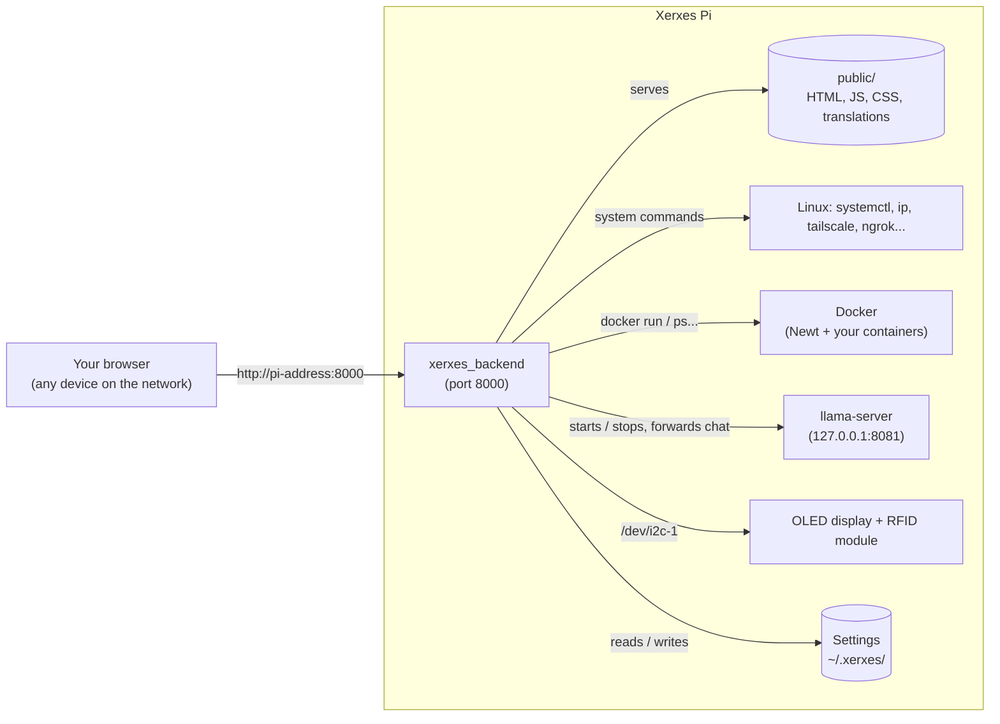

# Admin Panel: Architecture

This page explains how the Xerxes Pi Admin Panel is put together as a whole, and the limits of that design. Each feature's own `architecture.md` goes into more detail on that feature. For building and installing, see [setup.md](setup.md).

## The big picture

The panel is **one compiled C++ program**, `xerxes_backend`, as the project sponsor asked. It is a small web server on port 8000 that does two jobs:

1. It serves the web pages (from the `public/` folder) that you see in the browser.
2. It answers REST requests under `/api/...` from those pages, and carries them out on the device: running system commands, starting Docker containers, driving the I2C devices, and so on.



Only llama-server is a separate program (it is part of llama.cpp and is started by the backend when you turn Llama on). Newt runs in a Docker container that the backend manages. Everything else, including the RFID reader and the OLED display that used to be standalone programs, runs inside `xerxes_backend`.

## The web panel

The panel is plain HTML, CSS and JavaScript with no framework, so it needs no build step. It has seven tabs plus a chat window:

| Tab | What it does | Documented in |
| --- | --- | --- |
| **Dashboard** | Status cards (hostname, uptime, disk use, IP address), plus Reboot and Shutdown | — |
| **System** | Allow-listed diagnostic commands (disk use, uptime, memory, top processes, listening ports) | — |
| **Network** | Network details, static IP / DHCP, renaming the device | — |
| **Tunnels** | Tailscale, ngrok and **Newt (Pangolin)** remote access | [newt/](../newt/) for Newt |
| **Docker** | Start, stop and inspect containers | — |
| **Llama** | Run a local AI model with llama.cpp | [llama-cpp/](../llama-cpp/) |
| **I2C** | The **OLED display** and the **RFID reader** | [oled-display/](../oled-display/), [rfid/](../rfid/) |
| **Ask Xerxes AI** (button, bottom right, on every tab) | Chat with the model running on the Llama tab | [llama-cpp/](../llama-cpp/) |

A language menu in the top bar switches the whole panel between English and Spanish (see [internationalisation/](../internationalisation/)), and a toggle switches between light and dark themes.

## The parts of the code

| Part | Files (in `team-llama`) | What it does |
| --- | --- | --- |
| Entry point | `src/main.cpp` | Starts the RFID and OLED services and the daily Newt update check, registers the routes, then listens on `0.0.0.0:8000` |
| Routes | `src/router.cpp` | Every `/api/...` endpoint. Each one checks its input and calls the module below |
| System commands | `src/system_ops.cpp`, `src/utils.cpp`, `src/network_config.cpp` | Runs commands from a fixed allow-list (see `docs/COMMAND_WRAPPER.md` in `team-llama`), the hostname and network settings |
| Docker | `src/docker_manager.cpp` | Builds and runs `docker run` commands from validated fields |
| Newt | `src/newt_manager.cpp` | Newt container, status, updates and rollback |
| Llama | `src/llama_manager.cpp`, `llama_process.cpp`, `llama_proxy.cpp`, `model_downloader.cpp` | llama-server process, model files, chat forwarding |
| RFID | `src/rfid/` | PiicoDev RFID driver, tag file and the reader service |
| OLED | `src/oled/` | SSD1306 driver, screens, QR code and the display service |
| Web panel | `public/` | `index.html`, `app.js`, `i18n.js`, `styles.css`, `containers.json`, `llama-models.json`, `i18n/<lang>.json` |
| Headers | `include/` | The interface of each module |
| Tests | `tests/` | Unit tests run by `make test` |
| Packaging | `packaging/`, `deploy_systemd.sh` | The `xerxes.service` unit, `.deb` scripts, self-extracting installer |
| llama.cpp | `third_party/llama.cpp/` | The official llama.cpp source as a git submodule, pinned to release **b11062** |

Three things run in the background inside the backend:

- the **RFID worker**, which polls the module only while it is needed (run mode, live scan or a pending scan);
- the **OLED worker**, which redraws the screen every 2 seconds while the display is on (the panel has no memory of its own);
- the **Newt updater**, which checks for a new Newt version once a day if automatic updates are on.

## Where things are kept

The backend finds everything **relative to the folder it was started in**, so the deployed copy mirrors the repo:

```
/opt/xerxes/                                 (or the repo root when run by hand)
├── xerxes_backend
├── public/
├── models/                                  downloaded models (kept across deploys)
└── third_party/llama.cpp/build/bin/         llama-server and its .so libraries
```

Settings are kept separately, in the home folder of the user the backend runs as (`/root/.xerxes` for the service), or in `$XERXES_CONFIG_DIR` if set:

| File | Feature |
| --- | --- |
| `newt.env` (permissions `600`) | Newt endpoint, ID and secret |
| `newt-update.conf` | Newt automatic update setting and last check |
| `rfid.conf` | RFID bus, address, tag file and whether run mode is on |
| `tags.json` | Registered RFID tags and their commands (default location) |
| `oled.conf` | OLED on/off, what it shows, bus and address |

The language and theme you pick are saved in your browser, not on the device.

## The service

`deploy_systemd.sh` and `make deb` both install `packaging/xerxes.service`:

- It runs `/opt/xerxes/xerxes_backend` with `/opt/xerxes` as its working folder.
- It runs as **root**, which Docker (Newt), I2C (RFID and OLED) and system commands need.
- It sets `LD_LIBRARY_PATH` so llama-server finds its libraries in `/opt/xerxes/third_party/llama.cpp/build/bin`.
- It restarts the backend 3 seconds after any crash, and starts after the network and Docker at boot.
- Stopping the service also stops llama-server (`KillMode=control-group`), allowing up to 15 seconds.

## Limitations of this design

| Limitation | Effect | Possible improvement |
| --- | --- | --- |
| **No login** (`access_control.cpp` is empty) | Anyone who can reach port 8000 can use every feature, including rebooting, running Docker containers and registering RFID tag commands that run as root. The API also allows requests from any website (`Access-Control-Allow-Origin: *`). | Add authentication (NFR-13) and restrict CORS. Until then, keep port 8000 on a trusted network and never publish it through ngrok or Pangolin without their own login. |
| Plain HTTP | Traffic, including the Newt secret when you first enter it, is not encrypted on the local network. | Serve HTTPS, or reach the panel only through Tailscale (which is encrypted). |
| Runs as root | A bug in the backend could affect the whole device. | Run as a dedicated user with narrow `sudo` rules and group access to Docker and I2C. |
| Paths are relative to the working folder | Started from the wrong folder, the panel shows no pages, can't find llama-server and looks in the wrong `models/`. | Always start it from the repo root, or use the service. A future version could find its files relative to the program itself. |
| One program does everything | A crash in one feature takes the whole panel down (systemd restarts it within seconds, but a running Llama model is stopped). | Acceptable for the device's size; keep risky work (Newt, llama-server) in separate processes as now. |
| Some requests wait until the work finishes | Downloading a model or the first Newt image keeps the request open (up to an hour for a model), with no progress shown. | Run long jobs in the background and report progress. |
