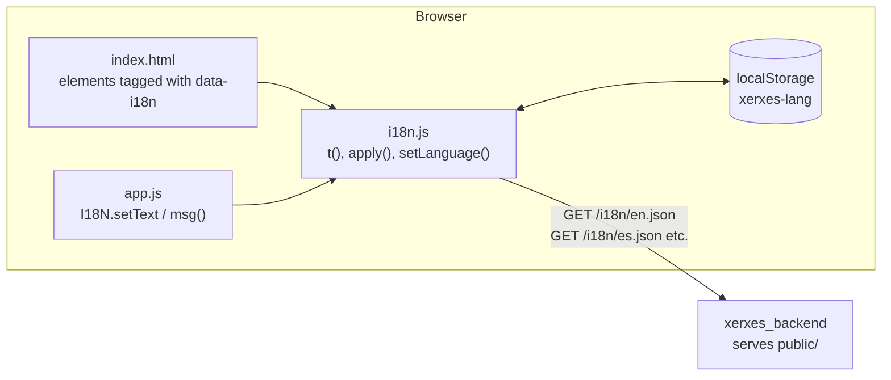

# Internationalisation: Architecture

This page explains how the admin panel is translated (SRS requirement FR-11), and the limits of that design. For using and extending it, see [setup.md](setup.md) and [commands.md](commands.md).

## The big picture

Translation happens entirely **in the browser**. The backend serves the same page to everyone, plus one JSON file per language, and `public/i18n.js` swaps the text on the page. Nothing in `xerxes_backend` needs to know which language a user has picked.

## How a page is translated

1. When the page loads, `i18n.js` works out the language: the one saved in the browser (`localStorage`, key `xerxes-lang`), otherwise the first of the browser's preferred languages the panel supports (`es-MX` matches `es`), otherwise English.
2. It always loads `en.json` first, as the **fallback**, then the chosen language.
3. It fills in every tagged element: text (`data-i18n`), HTML (`data-i18n-html`), placeholders, tooltips and screen-reader labels. It also sets the page title and the page's `lang` attribute.
4. When the user picks another language, it loads that file (once; it is then cached), re-applies every tag, saves the choice and fires an `i18n:change` event so code that builds parts of the page by hand can redraw them.

The page still works in English if a language file can't be loaded.

## Text set from JavaScript

Text that changes at run time (status badges, feedback messages, pop-ups) is written with `I18N.setText(el, key, params)`, which stores the key and its parameters on the element as `data-i18n` and `data-i18n-args`. That means a message shown before a language switch is re-translated by the switch too.

Helpers such as `showFeedback()` accept either a plain string or `msg(key, params)`. A plain string, such as command output or an error from the backend, is shown as-is and is not touched by a switch (`I18N.clear(el)` removes any old key first).

Placeholders can themselves be messages, so composite text like `"{hint} ({detail})"` is fully re-translated.

## Lookup rules

`t(key, params)` looks for the key in the current language, then in English, and returns the key itself if neither has it, so a missing string is obvious on screen. An empty string in a translation also falls back to English. `{name}` placeholders are replaced with the parameter values; an unknown placeholder is left as written.

## Text from the backend

The backend's own messages are in English. Two features avoid showing them to the user:

- **OLED** errors carry a `code` (e.g. `no_device`) that the page maps to `oled_err_<code>` in the translation files.
- **Known status words** from Linux and Docker (e.g. `active`, `running`) are translated through `badge_<word>` keys; unknown ones are shown as reported.

The other features mostly show the backend's English message when something goes wrong.

## Other translated content

- **Recommended models** (`public/llama-models.json`): each model's `note` has a text per language, falling back to `en`.
- **Ask Xerxes AI:** the system prompt stays in English, which small models follow best, but asks the model to reply in the panel's current language.

## Limitations of this design

| Limitation | Effect | Possible improvement |
| --- | --- | --- |
| Backend messages are in English | Errors from Newt (including the Docker fix steps), RFID, Llama and the system commands appear in English in the Spanish panel. | Have the backend return a code and parameters, like the OLED does, and keep the text in the translation files. |
| Command output is untranslated | Output of `df`, `docker`, `systemctl` and others is shown as the device prints it. | Not practical to translate; acceptable. |
| Choice is per browser, not per user | Clearing browser data, or using another browser, goes back to the default. | Save the choice on the device once the panel has user logins. |
| Left-to-right only | Languages such as Arabic or Hebrew would need layout changes. | Set `dir="rtl"` per language and check the styles. |
| No plural rules | Text like "1 tags" has to be avoided by wording rather than handled. | Add plural forms to the lookup if needed. |
| The OLED screen is English | The screen's labels (`IP`, `CPU`, `Scan to open the admin panel`) are fixed, and its font only has ASCII characters. | Accented characters would need a larger font. |
