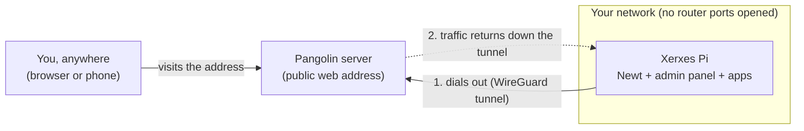
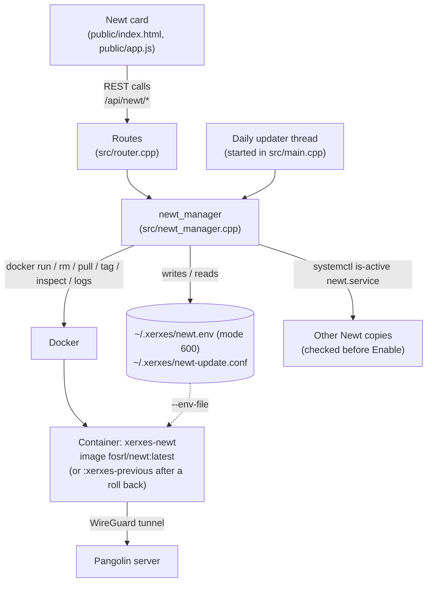

# Newt: Architecture

This page explains how Newt support in the Xerxes Pi admin panel is built, and the limits of that design. For setting it up, see [setup.md](setup.md).

## The big picture

Newt is a small program, made by the Pangolin project, that connects a device to a Pangolin server. The Xerxes Pi **dials out** to Pangolin over an encrypted WireGuard tunnel, so nothing has to be opened on the router. People then reach the Pi's services through the Pangolin server's public address, and Pangolin forwards their requests down the tunnel.

The admin panel does not contain Newt itself. It starts, stops, updates and watches Newt, which runs separately in a Docker container.

## The parts inside the Pi

| Part | File | What it does |
| --- | --- | --- |
| Newt card | `public/index.html`, `public/app.js`, `public/i18n/<lang>.json` | The form, status boxes, Docker fix box and Updates section on the **Tunnels** page. After **Enable** it checks the status every 3 seconds (up to about 45 seconds) until the tunnel settles. All text, including hints and error messages, comes from the translation files. |
| Routes | `src/router.cpp` | Nine REST endpoints under `/api/newt/`: `enable`, `disable`, `status`, `logs`, `docker-check`, `update/check`, `update`, `rollback` and `auto-update`. |
| newt_manager | `src/newt_manager.cpp`, `include/newt_manager.h` | Checks the input, saves the settings, runs the Docker commands, works out the tunnel's state, checks Docker access, finds other copies of Newt, and handles updates and roll back. |
| Daily updater | `newt_manager::start_auto_updater()` | A background thread that, 2 minutes after the panel starts and then every hour, runs an update if automatic updates are on and the last check was more than a day ago. |
| Settings files | `~/.xerxes/newt.env`, `~/.xerxes/newt-update.conf` | The endpoint, Newt ID and secret (readable only by the admin panel's user), and the update settings. |
| Newt container | Docker, named `xerxes-newt` | The official `fosrl/newt:latest` image, started with `--restart unless-stopped` so it survives reboots and admin panel restarts. |
| Unit tests | `tests/test_newt.cpp` | 19 tests for input checking, status detection, version parsing, update rules, Docker access states and fixes, and spotting other Newt containers. Run by `make test`. |

## What happens when you click Enable

1. The card checks the three fields in the browser and sends them to `POST /api/newt/enable`.
2. `newt_manager` checks them again on the server. Only letters, digits and a few address characters are allowed, which stops anyone slipping extra commands in.
3. If the Secret box was empty, the saved secret is reused.
4. It checks the panel can use Docker. If not, it stops with code `docker_access`, and the card asks `GET /api/newt/docker-check` for the reason and fixes to show.
5. It looks for **other copies of Newt**: a running `newt.service` (Newt installed directly, as on the sponsor's Pi) or any other container using a Newt image. If it finds any, it stops with code `conflict`, and the card asks the user to confirm. Confirming sends the request again with `force`.
6. The settings are written to `~/.xerxes/newt.env` with permissions `600`.
7. Any old `xerxes-newt` container is removed, so only one Newt managed by the panel ever runs.
8. `docker run -d --name xerxes-newt --restart unless-stopped --env-file ~/.xerxes/newt.env fosrl/newt:latest` starts Newt (or `fosrl/newt:xerxes-previous` if the user rolled back from the latest version). The secret goes in through the file, so it never appears on a command line.
9. The card then asks `GET /api/newt/status` every 3 seconds until the status settles.

## How the status is worked out

Newt has no status API of its own, so the admin panel reads two things:

1. **Is the container running?** (`docker inspect`). If not, the state is `stopped`, `not_configured` (never set up) or `docker_unavailable` (Docker can't be used).
2. **What did Newt last say?** (`docker logs --tail 200`). The **latest** matching line wins:

| Last matching log line | State | Shown as |
| --- | --- | --- |
| `Tunnel connection to server established` | `connected` | Connected |
| `failed to get token`, `No newt found`, status code 401 or 403 | `auth_failed` | Rejected |
| `Failed to connect` (any other reason) | `error` | Can't reach server |
| None of these yet | `connecting` | Connecting... |

Other warnings are ignored, so a passing hiccup doesn't flip the status. The version shown on the card comes from the `Newt version` line Newt prints when it starts.

## How updates work

The sponsor asked for Newt to keep itself up to date (16 October). An update (from **Update Now** or the daily updater):

1. Pulls `fosrl/newt:latest` and compares it with the image the container is running.
2. If it is newer, tags the running image as `fosrl/newt:xerxes-previous`, so there is always one version to go back to.
3. Recreates `xerxes-newt` on the new image.
4. If the tunnel was connected before, waits up to 60 seconds for it to reconnect. If it doesn't, restarts on `xerxes-previous` and records the new image as **skipped**, so the daily updater won't keep reinstalling a version that doesn't work. **Update Now** can still install it on purpose.

**Roll Back** restarts on `xerxes-previous` and marks the version it left as skipped in the same way. The result of each check is saved in `newt-update.conf` and shown on the card as *Last checked: ...*.

## Docker access check

Using Docker needs root-level rights, and on a normal user account the panel can't use it (defect D-01). `docker_check` runs `docker version`, classifies the output as `ok`, `permission_denied`, `sudo_denied`, `daemon_down`, `not_installed` or `error`, and returns ready-to-run fixes for that case, using the real user name the panel runs as:

| State | Fixes offered |
| --- | --- |
| `permission_denied` | Run the panel as the system service; add the user to the `docker` group; or allow only `docker` through `sudo` |
| `sudo_denied` | Set up the `sudo` rule for `docker` |
| `daemon_down` | `sudo systemctl enable --now docker` |
| `not_installed` | Install `docker.io` and start it |

For the `sudo` option, the panel is started with `XERXES_DOCKER='sudo -n docker'`. Only that exact value is accepted, so the variable can't be used to run another program.

## Security decisions

- **The secret never leaves the Pi once saved.** It is not logged (the server log prints `secret=(provided)` or `(saved)`), not returned by any API, and not shown in the card. The card's Secret box shows *Saved — leave blank to keep it* instead.
- **The settings file sits outside the website and the code repo**, in the admin panel user's home folder with permissions `600`, so it can't be downloaded from the admin panel or committed by accident.
- **Strict input checking** on both the browser and the server, plus quoting of the file path, prevents command injection. The tests cover attempts such as `;reboot`, `$(id)` and a newline smuggling a second setting into the file.
- **Docker command allow-list.** `XERXES_DOCKER` accepts only `docker` or `sudo -n docker`. The user name in suggested fixes is only shown if it is a valid Linux user name.
- **No accidental second Newt.** Enabling checks for other copies first, because two copies on one Site disconnect each other and could cut off a remote session running through the tunnel.

## Limitations of this design

| Limitation | Effect | Possible improvement |
| --- | --- | --- |
| Needs Docker, and the admin panel must be allowed to use it | Docker access is effectively root access, which conflicts with least-privilege (NFR-12). The panel now explains and offers fixes, but one of them still has to be applied. | Run Newt natively under systemd, as the sponsor already does on their Pi, controlled through a narrow `sudo` rule. |
| Status comes from Newt's log wording | A future Newt release that rewords its messages could leave the status stuck on **Connecting...**. Automatic updates make this more likely to happen without anyone noticing, although an update that never shows **Connected** is rolled back. Tested with Newt 1.18.1 against Pangolin server 1.21.1. | Use a Newt health or metrics endpoint if one becomes available. |
| Docker commands run while the request waits | The first **Enable** waits for the image download (about 36 MB); the card allows up to 5 minutes. An update can take over a minute while it waits for the tunnel. | Pull images in the background and report progress. |
| Roll back keeps only one older version | You can go back one update, not further. | Keep more tagged versions if needed. |
| Secret stored as plain text (permissions `600`) | Anyone with root on the Pi can read it. | Use a system secret store, or fetch credentials from Pangolin at startup. |
| One Newt (one Site) per device | Can't connect one Pi to two Pangolin servers at once. | Usually enough. Multiple named containers if ever needed. |
| Publishing services is done in Pangolin, not the admin panel | Users must use the Pangolin dashboard to add Resources, so feature parity with ngrok (FR-2) is not complete. | Use Pangolin's API to create Resources from the card. |
| Docker fix text is English only | The fix titles and explanations come from the backend, so they aren't translated when the panel is in Spanish. | Send codes from the backend and keep the text in the translation files. |
| The admin panel API has no login | Anyone on the local network can enable, disable or update Newt. Publishing the admin panel through Pangolin without Pangolin's own login would expose it to the internet. | Add authentication to the admin panel (NFR-13). Until then, always protect its Pangolin Resource with a login or PIN. |
