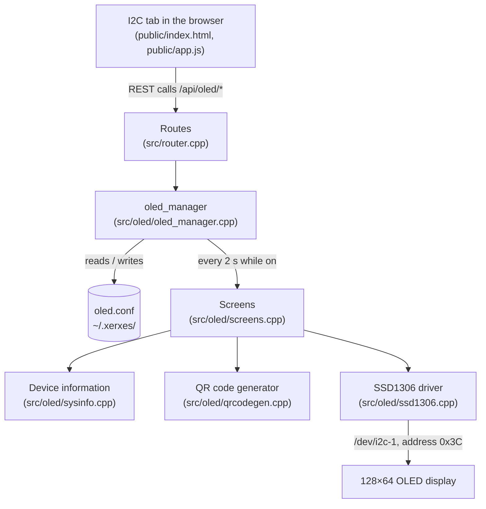

# OLED Display: Architecture

This page explains how the OLED display support is built, and the limits of that design. For setting it up, see [setup.md](setup.md).

The OLED driver started as a standalone single-file C++ program (`./oled`). It has now been merged into the admin panel (`xerxes_backend`), so it starts with the panel, is configured from the **I2C** tab, and has no command-line options of its own. It covers SRS requirements FR-3 to FR-6.

## The parts

| Part | File | What it does |
| --- | --- | --- |
| SSD1306 driver | `src/oled/ssd1306.cpp`, `ssd1306.h` | Talks to the display over Linux I2C (`/dev/i2c-N`). Keeps a 128×64 framebuffer in memory, draws a 5×7 ASCII font into it, and sends the whole buffer to the display at once, so the screen doesn't flicker. Can also print the framebuffer to a terminal. |
| Device information | `src/oled/sysinfo.cpp`, `sysinfo.h` | Reads the hostname, IPv4 address, DNS server, CPU temperature, uptime, memory and disk use from Linux files. |
| Screens | `src/oled/screens.cpp`, `screens.h` | Draws the two screens: the device information list and the QR code. Also defines the list of available items. |
| QR code generator | `src/oled/qrcodegen.cpp`, `qrcodegen.hpp` | [Project Nayuki's QR Code generator](https://github.com/nayuki/QR-Code-generator) (MIT licence). |
| oled_manager | `src/oled/oled_manager.cpp`, `include/oled_manager.h` | The display service behind `/api/oled/*`: settings, the worker thread, connection test and preview. |
| I2C tab | `public/index.html`, `public/app.js` | The **OLED Display** section: on/off, mode, items, live preview and settings. |
| Unit tests | `tests/test_oled_manager.cpp` | Settings loading and saving, input checks, power, a missing display, and the preview. Run by `make test` with no display needed. |

## How the display is driven

The display has no memory of its own beyond what is currently shown, so a **worker thread** inside the backend keeps it up to date:

1. When the panel starts, `oled_manager` reads `oled.conf` and starts the worker.
2. While the display is **on**, the worker opens the I2C bus, initialises the display, and every **2 seconds** draws the chosen screen into the framebuffer and sends it.
3. A change from the panel (mode, items, bus, address) wakes the worker straight away rather than waiting for the next refresh.
4. If the bus doesn't exist, nothing answers at the address, or a write fails, the worker records an error code (`no_bus`, `no_device`, `write_failed`) for the page to show, and retries every 3 seconds. The saved settings are kept, so the screen returns by itself when the display is reconnected.
5. When the display is turned **off**, the worker clears the screen, switches the display off and lets go of the bus.

**Test Connection** asks the worker to re-initialise the display once and waits up to 5 seconds for the result.

## The screens

**Device information** draws one item per line (8 lines of 21 characters). Each line starts with a 4-character label and a space (`IP   `, `DNS  `, `CPU  `, `UP   `, `MEM  `, `DISK `) so the values line up and a full IPv4 address fits. With four or fewer items, a blank line is left between them.

**QR code** encodes the admin panel's address, `http://<first IPv4 address>:8000`, with low error correction, and draws it in the left 64×64 pixels. The QR area is lit and the dark squares are turned off, because phone scanners need dark squares on a light background. *Scan to open the admin panel* is written on the right. If the Pi has no IPv4 address, it shows *No network* instead.

## The preview

`GET /api/oled/preview` runs the same drawing code into a framebuffer that is never sent to the display, and returns it as 64 rows of hex. The page draws this on a canvas, so the preview always matches the real screen and works on machines without a display (for example a VM).

## Error messages and languages

Errors from the backend carry a short `code` (e.g. `no_device`, `invalid_address`) as well as an English `error` message. The page shows the translated text for the code from `public/i18n/<lang>.json`, so OLED errors appear in the panel's language. The English message is used in the log and by `curl`.

## Technical Limitations

| Limitation | Effect | Possible improvement |
| --- | --- | --- |
| The QR code uses the first IPv4 address found | On a Pi with several networks (Ethernet, Wi-Fi, Docker, Tailscale) it may not be the address you can reach. The *No network* screen also only mentions a cable, although Wi-Fi works too. | Prefer the default-route interface, or let the user pick the address. |
| Fixed QR content | The QR code always links to the admin panel on port 8000; custom text (possible with the old `./oled qr <text>`) is gone. | Add a custom QR text option. |
| Refresh every 2 seconds | Values such as CPU temperature can be up to 2 seconds old, and the bus is written every 2 seconds while the display is on. | Make the refresh rate a setting. |
| One display | The panel drives one display at one address. | Usually enough. |
| No startup screen | The old program's "XerxesPi" startup screen was dropped; the screen shows device information as soon as the panel starts. | Add an optional startup screen. |
| SSD1306 only | Other display controllers (e.g. SH1106) aren't supported. | Add drivers if other panels are used. |
| No login | Like the rest of the panel, anyone on the network can change the display. | See [admin-panel/to-improve.md](../admin-panel/to-improve.md). |
