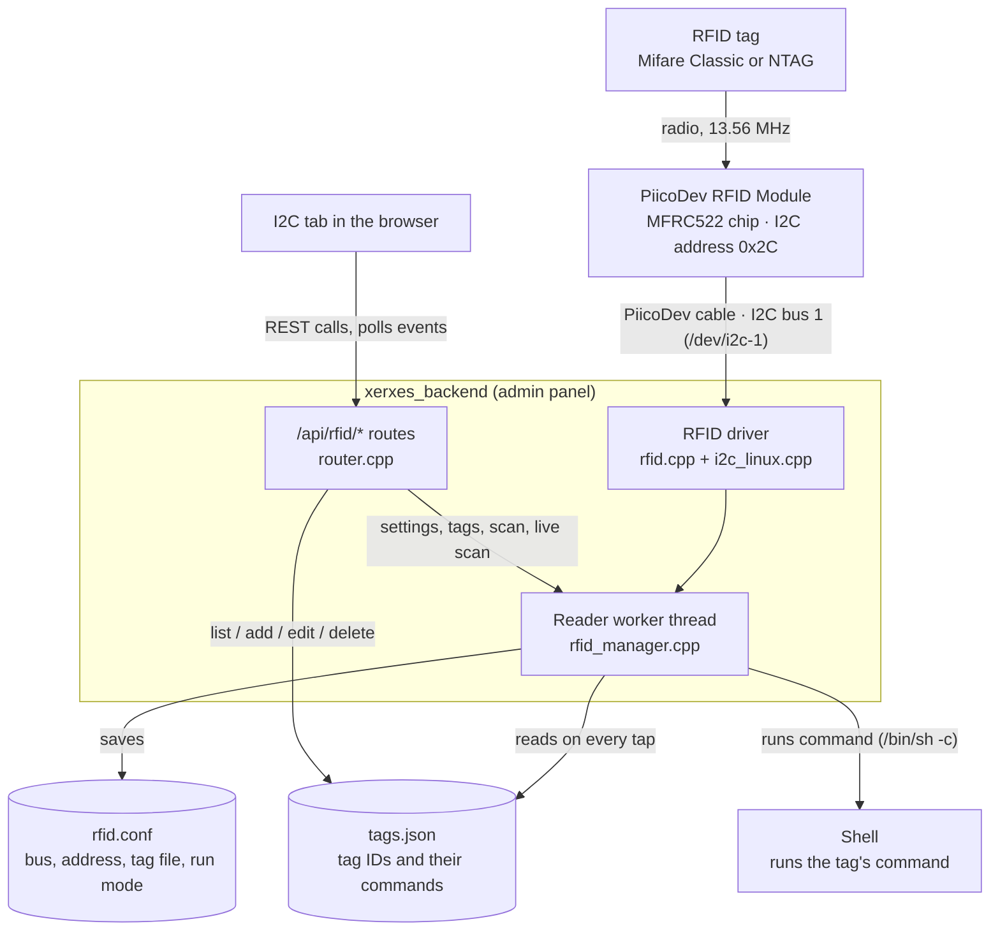

# RFID Architecture

RFID support for the Xerxes Pi V2 Administration System is now written in C++ and built into the admin panel (`xerxes_backend`), as the sponsor asked. It is a port of the Python `xerxes-rfid` programs (via their `cpp-rewrite`), and keeps the same `tags.json` format and behaviour, with a web page on the **I2C** tab in place of the terminal menu.

The code is in the `team-llama` repo:
- `src/rfid/rfid.cpp`, `include/rfid.h`: the driver for the RFID module's MFRC522 chip. It is a port of Core Electronics' `PiicoDev_RFID.py` and sends exactly the same I2C traffic.
- `src/rfid/i2c_linux.cpp`, `include/i2c.h`: talks to `/dev/i2c-N`.
- `src/rfid/tags.cpp`, `include/tags.h`: loads and saves `tags.json`, in the same layout as the Python version.
- `src/rfid/rfid_manager.cpp`, `include/rfid_manager.h`: the reader service behind the `/api/rfid/*` endpoints. It replaces `xerxes-rfid.py` (reading tags and running commands) and `tag-management.py` (managing tags).
- `public/index.html`, `public/app.js`: the **RFID Reader** section of the **I2C** tab.


## Overview



## Hardware
The PiicoDev RFID Module (NFC 13.56MHz) reads the unique identifiers of standard Mifare Classic or NTAG213/NTAG203 RFID tags, communicating with the main Xerxes Pi board over I2C. Due to the nature of I2C, multiple of these modules could be daisy chained together. The RFID Module can also be daisy chained with the OLED display, which uses a different address (`0x3C`).

Depending on the tags used, unique identifiers are either 4-bytes long (Mifare Classic) or 7-bytes long (NTAG213/NTAG203). Testing was done on Mifare Classic tags, however either tag will work with the system.


## Dependencies
None beyond the admin panel itself. The driver talks to the Linux I2C device directly, so Python, `piicodev` and `smbus2` are no longer needed. I2C must be enabled in `raspi-config`.


## Reader service (rfid_manager)
A single **worker thread** owns the I2C bus. The web requests only change its settings and wake it up, so a slow command or a missing module never holds up the rest of the panel.

The worker only uses the bus while something needs it: run mode, live scan or a pending **Scan Tag**. Otherwise it closes the bus, so a Pi without the module simply shows **Idle**. If the module can't be opened, it retries every 3 seconds and reports the error on the page.

While active, it checks for a tag every 10ms (100ms during live scan), with the same timings as the original program. When a tag is read:
1. If a **Scan Tag** is waiting, the ID is handed to the page to register it, and **no command is run**.
2. Otherwise it reads `tags.json` **on every tap**, so edits apply immediately.
3. If live scan is on, it adds a live scan entry with the tag's details.
4. If run mode is on and the tag is registered, it runs the command with `/bin/sh -c` and waits for it to finish, capturing up to 16 KB of output and the exit code. Unknown tags are noted and ignored.
5. Waits 1 second, so a single tap is not read many times in a row.

Everything that happens is added to an **event list** (the last 300 events). The page fetches new events by number (`/api/rfid/events?since=N`) to fill **Reader Output** and **Live Scan**. If no page has asked for events for 20 seconds, live scan stops by itself.


## Tag management
- Adding, editing and deleting tags re-reads `tags.json`, changes it, and writes the whole file back out. Nothing is cached, so the file can also be edited by hand.
- If `tags.json` doesn't exist, it is treated as having no tags and is created when the first tag is added.
- If `tags.json` can't be read, the panel shows the error and refuses to change it, so a damaged file is never overwritten.
- Each tag can only have one command. Adding a tag that already exists is refused with its current command, so the page can offer to edit it instead.
- Tag IDs are stored in upper case with `:` between bytes, so matching is not case sensitive.


## tags.json
A JSON file with a single `tags` list. Each entry has:
- `id`: the tag's ID (as shown by *Live Scan*)
- `command`: the Bash command to run

```json
{
    "tags": [
        {
            "id": "DC:BD:6A:03",
            "command": "apt update"
        }
    ]
}
```

By default it is `tags.json` in the panel's settings folder (`/root/.xerxes/` when deployed). Another file can be chosen under **Reader Settings**.


## rfid.conf
Saved in the same folder whenever the settings or run mode change. It holds the bus, address, tag file path and whether run mode is on. When the panel starts, it reads this file and turns run mode back on if it was left on.


## Testing
`make test` runs two RFID test suites against `tests/mfrc522_sim.cpp`, a simulated module that stands in for `/dev/i2c-N`, so no hardware is needed:
- `tests/test_rfid_driver.cpp` checks the driver's results and every I2C register access against those recorded from the original Python driver.
- `tests/test_rfid_manager.cpp` covers the reader service: tapping tags, scanning, run mode, live scan, tag editing, settings and a corrupt `tags.json`.


## Technical Limitations
- **Repeated execution:** the only protection against re-reading a tag is the 1 second wait. A tag left on the reader runs its command again every second (plus however long the command takes).
- **Commands block reading:** commands run one at a time and the reader waits for each to finish. While a command is running (e.g. `apt update`), no other tags are read. There is no time limit, so a command that never finishes stops the reader until it is killed.
- **Permissions:** commands run as the admin panel's user, which is **root** when deployed. Anyone who can edit `tags.json`, **or use the panel**, can make a tag run any command as root, and the panel has no login yet. Keep port 8000 on a trusted network.
- **Security of tags:** tags are identified only by their UID, which is not secret and can be copied to another tag. Tags should be treated as a convenience, not as authentication.
- **One module:** the panel drives one RFID module at one address.
- **Logging:** reads and command output go to the panel's log (`journalctl -u xerxes`) and the page, but there is no separate history file. The page only keeps the last 300 events.
- **Don't run the old program alongside:** if `xerxes-rfid.py` is still installed, running it while run mode is on means both poll the same module.
